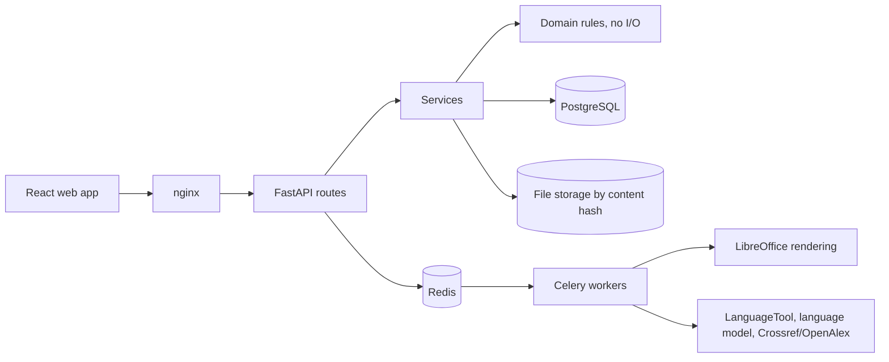

# AKSHARA

A platform for checking, fixing and creating professional documents (DOCX, PDF and PPTX).

> **Status:** all 9 planned phases are built and tested. What was verified in each phase, and what
> is deliberately not built yet, is listed in [docs/ARCHITECTURE.md](docs/ARCHITECTURE.md) (§9).

## ABOUT

Reports, theses and slide decks often have to follow strict rules: heading levels, numbering,
captions, margins, fonts and citation styles such as IEEE or APA. Checking all of that by hand is
slow and easy to get wrong.

AKSHARA does that work. You upload a document, it reads the structure, checks it against a
*standard*, explains what's wrong, and offers fixes you approve one by one. It can also write new
documents and slide decks from a short brief, and check that every reference really exists.

Every uploaded file is kept as an unchangeable original, and each edit creates a new *version*, so
nothing is ever lost. AKSHARA never invents references or formatting rules, and never changes a
document without your approval.

## WHAT IT DOES

| Phase | What works |
|---|---|
| 1. Foundation | Accounts, secure uploads (real file type checked, *zip bombs* and *macros* rejected), unchangeable originals, version history, document library |
| 2. Document intelligence | Reads all three formats into one internal model and previews every page or slide |
| 3. Inspection | Finds structure and formatting problems, graded by severity, with a quality score and report |
| 4. Standards | Built-in IEEE, APA and MLA rule sets, your own custom standards, and compliance reports |
| 5. Editing | Rule-based fixes, grammar fixes, AI and manual edits, each one a proposal you accept or reject; applying them creates a new version and re-checks it |
| 6. Generation | Ten document types written outline first, section by section, exported to DOCX or PDF; AI drafts may cite only references you supply |
| 7. Presentations | Themed slide decks from a document, an outline or a brief, with text that always fits, slide numbers and speaker notes |
| 8. Visual checks | Spots layout problems on the rendered page: content cut off or in the margin, blank pages, overlapping text, low contrast, misaligned lines, and marks them on the page |
| 9. Research | Checks every reference's DOI against Crossref and OpenAlex, flags mismatches and DOIs that don't exist, tests links, and builds a custom standard from your own style guide |

Some features need an extra service: grammar needs LanguageTool, AI features need a language model
(and each user's consent), and reference checks need internet access. If a service isn't set up,
the feature shows as unavailable instead of pretending to work.

## HOW IT WORKS

1. The React web app sends the file to the API.
2. The API checks the file is safe and really is the type it claims to be.
3. The file is stored by its content hash, so the same file is never stored twice, and a *version*
   record is added to PostgreSQL.
4. A background worker (Celery and Redis) reads the document, renders its pages with LibreOffice,
   and runs the inspection and standard checks.
5. Fixes you accept are written into a copy of the original file, which becomes the next *version*
   and is checked again.

## ARCHITECTURE



The code is layered: routes call services, services call the database and storage, and the core rules never touch I/O. An automated check keeps those layers apart.

## TECH STACK

<p align="center">
  
  
  
  
  
  
  
  
  
  
  
  
  
</p>

| Layer | Technology |
|---|---|
| API | Python 3.12, FastAPI, Pydantic |
| Data | PostgreSQL 16, SQLAlchemy, Alembic |
| Background jobs | Celery, Redis 7 |
| Documents | python-docx, python-pptx, PyMuPDF, LibreOffice (rendering) |
| Optional services | LanguageTool (grammar), Claude via the Anthropic SDK (AI features), Crossref and OpenAlex (references) |
| Web app | React, TypeScript, Vite, Tailwind CSS, TanStack Query, React Bits |
| Infrastructure | Docker Compose, nginx |
| Quality | pytest, Vitest, Playwright, ruff, mypy (strict), import-linter, ESLint |

## GETTING STARTED

### WITH DOCKER (EASIEST)

```bash
git clone https://github.com/Iamshi-vissa/Akshara.git
cd Akshara
cp .env.example .env    # then set AKSHARA_JWT_SECRET and POSTGRES_PASSWORD
docker compose up -d --build
```

Open <http://localhost:8080>.

To make a JWT secret: `python -c "import secrets; print(secrets.token_urlsafe(48))"`

Optional settings in `.env`: `AKSHARA_LLM_PROVIDER=anthropic` turns on AI features (with an
Anthropic API key; each user must also allow it in Settings), and `AKSHARA_REFERENCE_LOOKUPS=false`
turns off reference checks on servers without internet access.

### FOR LOCAL DEVELOPMENT

You need Python 3.12+, [uv](https://docs.astral.sh/uv/), Node.js 22, PostgreSQL 16, Redis 7 and
LibreOffice (for page previews).

```bash
cp .env.example backend/.env    # point AKSHARA_DATABASE_URL at your database
make install                    # backend and frontend dependencies
make migrate                    # create the database tables
make dev-api                    # API at http://localhost:8000/api/docs
make dev-web                    # web app at http://localhost:5173
```

Run `make help` to see every command.

## RUNNING THE TESTS

```bash
make lint            # ruff, mypy, import-linter, TypeScript and ESLint
make test            # 179 backend tests (needs PostgreSQL and Redis) and 15 frontend tests
./scripts/verify.sh  # all of the above plus the production build; stops at the first failure
```

The backend tests create and delete their own database, `akshara_test`. Don't point them at real
data. Reference tests replay real Crossref and OpenAlex answers recorded once, so they run offline;
to check against the live services, run `AKSHARA_TEST_NETWORK=1 uv run pytest -k live` in
`backend/`. Browser end-to-end checks are described in [e2e/README.md](e2e/README.md).

## PROJECT STRUCTURE

```
backend/    FastAPI app, database migrations, background workers and tests
frontend/   React web app
infra/      Dockerfiles and nginx config
docs/       architecture plan and design decisions
e2e/        browser end-to-end checks
scripts/    verify.sh, the full check run before every commit
```

## LICENSE

MIT. See [LICENSE](LICENSE).
